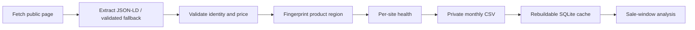

# Architecture

The collector validates the catalog before network access. Per-product errors become observation rows so other products can continue. The durable observations, health history, fingerprints and spot-check outcomes stay in a separate private data repository. SQLite is derived from CSV. Offline tests use temporary directories and synthetic fixtures where genuine saved pages are unavailable.
